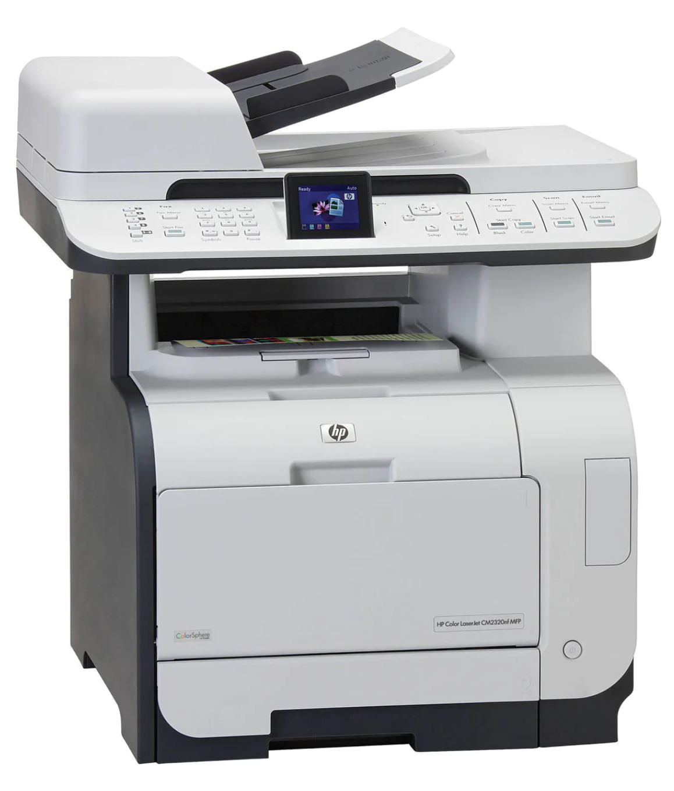
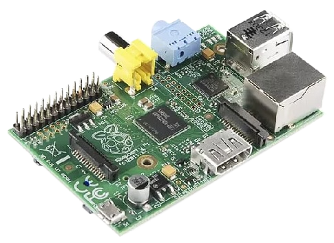
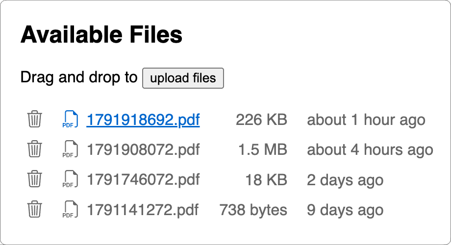

# Lambada scan server

[](https://github.com/woodie/lambada)
[](https://github.com/woodie/lambada/actions/workflows/ci.yml)
[](https://github.com/woodie/lambada/releases/latest)
[](LICENSE)

Have an old Scanner/Printer that requires an open relay to e-mail out scans?
Now you can serve up scanned documents on your home network.

&nbsp;&nbsp;
<br>
<br>
A lot of perfectly good scanners and printers end up in a landfill the
day their cloud-email feature stops working -- usually because the auth
method it depends on (an open relay, a now-revoked app password) quietly
breaks somewhere upstream, and the manufacturer has no reason to fix
firmware on hardware that old. If your printer can still email a scan
to *somewhere*, lambada plus an SMTP open relay it trusts (its own,
deliberately -- see Installation) is enough to keep it useful for years
past the cloud feature's death, on hardware as small as a Pi Zero.

## How it works

Two pieces share one folder, `/srv/lambada/attachments`:

- **`lambada`** -- a minimal SMTP server, the one thing this repo builds.
  The scanner emails a scan to the Pi; `lambada` decodes the attachment and
  saves it with an epoch-based name (e.g. `1779867473.pdf`). Each time a
  scan arrives, scans older than 24 hours are deleted. Only files named like
  that (ten digits, `.pdf`) are ever deleted; anything else stays until
  someone deletes it.
- **nginx** -- serves the folder over WebDAV at `http://<pi>/`, using
  [`service/lambada.nginx.conf`](service/lambada.nginx.conf). A browser
  gets a page listing each file like Finder's list view (name, size, age),
  with download, upload and delete. WebDAV clients get the folder itself:
  list, download, upload and delete.

The server uses WebDAV, so there are [several ways](docs/USAGE.md)
to download scans.

## Installation

On the Pi, with Go 1.26 or newer installed:

```bash
sudo apt-get update
sudo apt-get install -y git nginx libnginx-mod-http-dav-ext iptables-persistent

mkdir -p ~/workspace && cd ~/workspace
git clone https://github.com/woodie/lambada.git
cd lambada

# Build lambada, install it to /usr/local/bin, and set up /srv/lambada
# (prompts for sudo only if those locations aren't already writable)
make install

# Redirect port 25 -> 2525 so lambada can run as a non-root user
sudo iptables -t nat -A PREROUTING -p tcp --dport 25 -j REDIRECT --to-port 2525
sudo netfilter-persistent save

# Start lambada (edit User= first if you don't log in as pi)
sudo cp service/lambada.service /etc/systemd/system/
sudo systemctl daemon-reload
sudo systemctl enable --now lambada
sudo systemctl status lambada --no-pager

# Serve the folder with nginx on port 80
sudo cp service/lambada.nginx.conf /etc/nginx/sites-available/lambada
sudo ln -sf /etc/nginx/sites-available/lambada /etc/nginx/sites-enabled/lambada
sudo rm -f /etc/nginx/sites-enabled/default
sudo nginx -t && sudo systemctl reload nginx
```

## Scanner configuration

Open the scanner's own settings page (usually its IP address in a browser)
and find its e-mail or SMTP settings:

- Turn on sending e-mail directly from the scanner.
- Set the **SMTP Gateway** (or SMTP server) to the IP address of your Pi.
- Set the **SMTP Port** to `25`.
- Leave login, SSL and TLS off. lambada accepts mail from anyone on your
  network, so no account is needed.
- The sender doesn't matter: the "From" address, display name and default
  subject can be anything.
- Add a contact to scan to, such as "Scans" at `scans@example.com`. The
  address is never used: the e-mail is never delivered anywhere, because
  lambada saves the attached scan and throws the rest of the message away.
  So any address will do, and naming the contact after the Pi (for example
  "Scans: 10.0.1.111") makes it easy to pick on the scanner's screen.

Scan something to e-mail, then open `http://<pi>/` to see it. See
[DEVELOPMENT.md](docs/DEVELOPMENT.md) for updating, testing and
troubleshooting.
