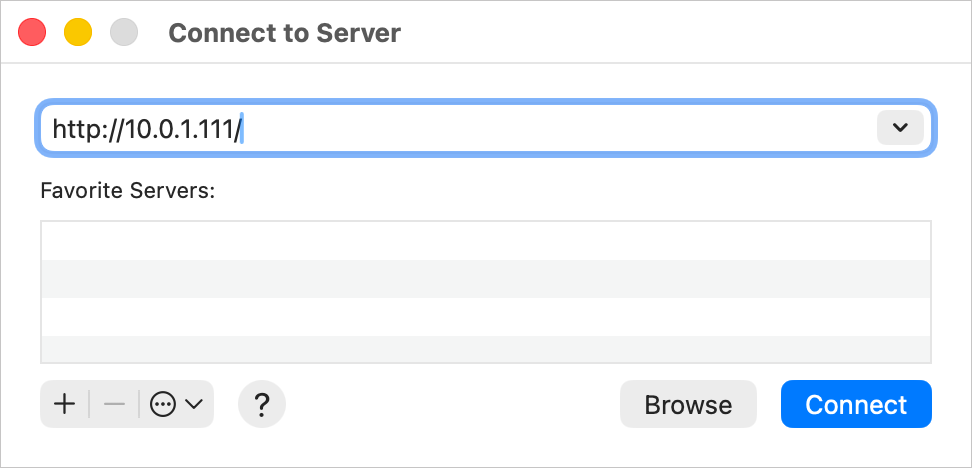
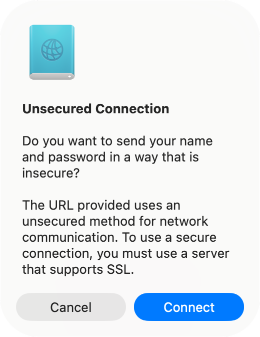
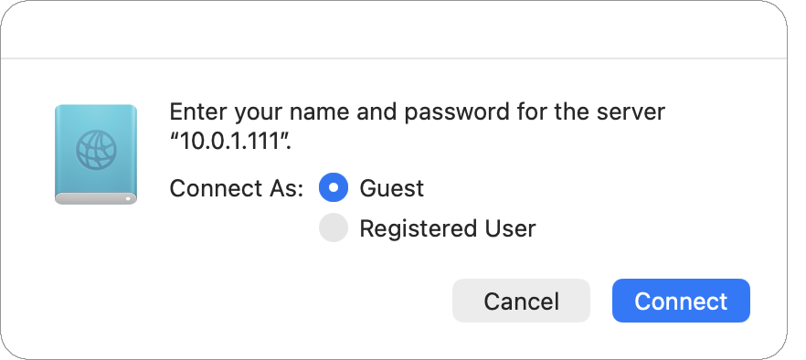

# Using lambada

Everything lambada has received, plus anything you've uploaded, is in one
folder on the Pi. You can reach it from any computer or phone on your home
network at the Pi's address, for example `http://10.0.1.111/` (or the Pi's
name, if your network has one for it). No login is needed.

## In a web browser

Open the Pi's address. You'll see every file with its name, size and how
long ago it arrived, newest first:

- **Download:** click a file's name. Browsers warn about downloads over plain
  HTTP (lambada runs on your home network, without HTTPS), so expect to
  click "Keep" once per download.
- **Delete:** click the trash can next to the file, then confirm.
- **Upload:** drag files from your desktop onto the page, or click
  **upload files** and pick them. Each file can be up to 25 MB. If a file
  with the same name is already there, you're asked before it's replaced.

The page works on a phone too: tap a name to open the file, and use
**upload files** to send a photo or document from the phone.

## On a Mac: Finder (Go → Connect to Server)

Finder can open the folder like a disk, which is handy for dragging several
files in or out at once.

In Finder, choose **Go → Connect to Server…** (⌘K), type the Pi's address,
and click **Connect**. Click **+** first if you'd like to keep it under
Favorite Servers.

   

Finder warns that the connection isn't secure, because it's plain HTTP.
That's expected on your home network, and you won't be sending a
password. Click **Connect**.

   

Choose **Guest** and click **Connect**.

   

The folder opens in a Finder window. Drag files out to copy them to your Mac,
drag files in to upload them (up to 25 MB each), or move a file to the Trash
to delete it from the Pi. Renaming files and making folders aren't
supported. When you're done, eject it like any other disk.

## On Windows: File Explorer (Map network drive)

Windows can open the folder as a network drive, with a letter of its own.
It uses Windows' built-in WebDAV support (the WebClient service), which is
included in Windows 10 and 11.

1. Open **File Explorer**, right-click **This PC**, and choose
   **Map network drive…** (in Windows 11, it may be under **Show more
   options**).
2. Pick a drive letter, and for **Folder** type the Pi's address, for
   example `http://10.0.1.111/`. Tick **Reconnect at sign-in** if you'd like
   it back every time. Leave **Connect using different credentials**
   unticked, since there's no login.
3. Click **Finish**. The folder opens as a new drive under This PC.

Drag files out to copy them to your PC, or drag files in to upload them (up
to 25 MB each). Deleting a file there deletes it from the Pi right away; it
doesn't go to the Recycle Bin. Renaming files and making folders aren't
supported. To remove the drive, right-click it under This PC and choose
**Disconnect**.

If Windows says it can't find or reach the folder, the WebClient service is
probably stopped: open **Services**, find **WebClient**, set its startup
type to **Automatic**, and click **Start**. Then try again.

## zouk and huck

[zouk](https://github.com/woodie/zouk) (for macOS) and
[huck](https://github.com/woodie/huck) (for Windows and macOS) are small apps
that show lambada's scans as a grid of thumbnails and download them with one
click, without the browser's download warnings.

## Good to know

- Scans are named by when they arrived (for example `1791851911.pdf`). Each
  time a new scan comes in, scans older than a day are deleted. Files you
  upload stay until someone deletes them.
- Anyone on your network can see, download, upload and delete files, so keep
  lambada on a home network you trust.
